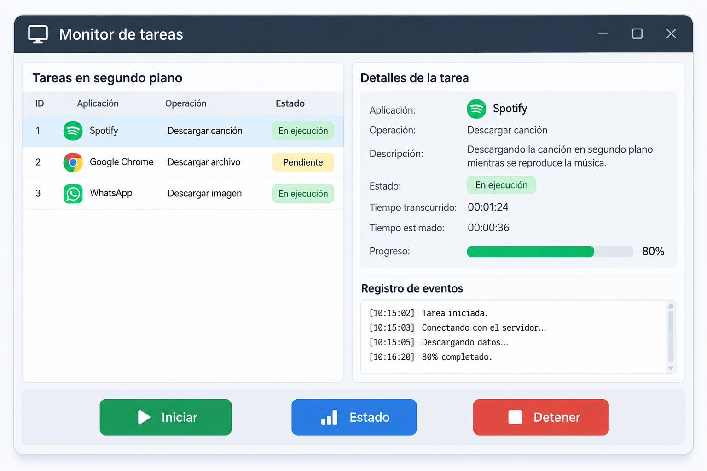

# Sesión 25 - Investigación sobre tareas concurrentes

## Descripción

En esta actividad investigamos tres aplicaciones que utilizan tareas concurrentes y diseñamos un boceto de un monitor de tareas.

El propósito es comprender cómo funcionan las operaciones en segundo plano y cómo pueden administrarse mediante una interfaz gráfica.

## Aplicaciones investigadas

### 1. Spotify

Permite reproducir música mientras descarga canciones en segundo plano.

[Ver investigación de Spotify](spotify.md)

### 2. Google Chrome

Permite descargar archivos mientras el usuario continúa navegando por internet.

[Ver investigación de Chrome](chrome.md)

### 3. WhatsApp

Permite recibir mensajes y descargar archivos mientras el usuario utiliza otras conversaciones.

[Ver investigación de WhatsApp](whatsapp.md)

## Monitor de tareas

Diseñamos un boceto de una interfaz que permite visualizar y administrar tareas concurrentes.

La interfaz incluye:

- Iniciar: comienza una tarea.
- Estado: consulta el estado de ejecución.
- Detener: solicita cancelar una tarea.
- Barra de progreso: muestra el avance.
- Registro de eventos: muestra las actividades realizadas.

[Ver explicación del monitor](monitor/monitor.md)

### Boceto

## Conclusión

Las tareas concurrentes son importantes porque permiten que las aplicaciones realicen distintas operaciones durante un mismo período de tiempo.

Gracias a esto, los usuarios pueden continuar utilizando una aplicación mientras se ejecutan procesos en segundo plano.

## Integrantes

- Adolfo Carlos Ramirez Arauz: Investigación de Spotify.
- Carlos Fernando Torres Gonzales: Investigación de Google Chrome.
- Andy Steven Diaz Montenegro: Investigación de WhatsApp.
- Alexa Sofia Loaisiga Torrez: Diseño y explicación del monitor de tareas.
